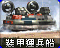
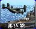
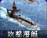
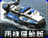
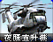

# 红警 2 原版 · 基础

[返回版本索引](../README.md) · [返回总索引](../../README.md)

红警 2 原版 · 主榜 · 全部阵营 / 全部类别 / 基础；共 44 项。

此索引按“全部类别”查询；登月火箭员仅在空中类别查询出现，不设科技阶段。

| 图片 | 名称／游戏 ID | 阵营 | 原分类 | 科技阶段 | 说明 |
|---|---|---|---|---|---|
|  | 美国大兵 / `E1` | 盟军 | 步兵 | 基础 |  |
|  | 动员兵 / `E2` | 苏军 | 步兵 | 基础 |  |
|  | 磁爆步兵 / `SHK` | 苏军 | 步兵 | 基础 |  |
|  | 工程师 / `ENGINEER` | 盟军 | 步兵 | 基础 |  |
|  | 军犬 / `DOG` | 苏军 | 步兵 | 基础 |  |
|  | 工程师 / `SENGINEER` | 苏军 | 步兵 | 基础 |  |
|  | 军犬 / `ADOG` | 盟军 | 步兵 | 基础 |  |
|  | 盟军基地车 / `AMCV` | 盟军 | 地面载具 | 基础 |  |
|  | 武装采矿车 / `HARV` | 苏军 | 地面载具 | 基础 |  |
|  | 犀牛坦克 / `HTNK` | 苏军 | 地面载具 | 基础 |  |
|  | 苏军运输船 / `SAPC` | 苏军 | 海军 | 基础 |  |
|  | 灰熊坦克 / `MTNK` | 盟军 | 地面载具 | 基础 |  |
|  | 恐怖机器人 / `DRON` | 苏军 | 地面载具 | 基础 |  |
|  | 防空履带车 / `HTK` | 苏军 | 地面载具 | 基础 |  |
|  | 驱逐舰 / `DEST` | 盟军 | 海军 | 基础 |  |
|  | 台风潜艇 / `SUB` | 苏军 | 海军 | 基础 |  |
|  | 盟军运输船 / `LCRF` | 盟军 | 海军 | 基础 |  |
|  | 夜鹰直升机 / `SHAD` | 盟军 | 空中单位 | 基础 |  |
|  | 苏军基地车 / `SMCV` | 苏军 | 地面载具 | 基础 |  |
|  | 超时空采矿车 / `CMIN` | 盟军 | 地面载具 | 基础 |  |
|  | 多功能步兵车 / `FV` | 盟军 | 地面载具 | 基础 |  |
|  | 发电厂 / `GAPOWR` | 盟军 | 普通建筑 | 基础 |  |
|  | 盟军矿石精炼厂 / `GAREFN` | 盟军 | 普通建筑 | 基础 |  |
|  | 盟军建造厂 / `GACNST` | 盟军 | 普通建筑 | 基础 | 无独立图标，使用阵营标志 |
|  | 盟军兵营 / `GAPILE` | 盟军 | 普通建筑 | 基础 |  |
|  | 盟军维修厂 / `GADEPT` | 盟军 | 普通建筑 | 基础 |  |
|  | 盟军战车工厂 / `GAWEAP` | 盟军 | 普通建筑 | 基础 |  |
|  | 磁能反应炉 / `NAPOWR` | 苏军 | 普通建筑 | 基础 |  |
|  | 苏军兵营 / `NAHAND` | 苏军 | 普通建筑 | 基础 |  |
|  | 盟军围墙 / `GAWALL` | 盟军 | 防御及超级武器 | 基础 |  |
|  | 雷达 / `NARADR` | 苏军 | 普通建筑 | 基础 |  |
|  | 苏军战车工厂 / `NAWEAP` | 苏军 | 普通建筑 | 基础 |  |
|  | 苏军矿石精炼厂 / `NAREFN` | 苏军 | 普通建筑 | 基础 |  |
|  | 苏军围墙 / `NAWALL` | 苏军 | 防御及超级武器 | 基础 |  |
|  | 哨戒炮 / `NALASR` | 苏军 | 防御及超级武器 | 基础 |  |
|  | 爱国者导弹 / `NASAM` | 盟军 | 防御及超级武器 | 基础 |  |
|  | 盟军船厂 / `GAYARD` | 盟军 | 普通建筑 | 基础 |  |
|  | 苏军建造厂 / `NACNST` | 苏军 | 普通建筑 | 基础 | 无独立图标，使用阵营标志 |
|  | 苏军维修厂 / `NADEPT` | 苏军 | 普通建筑 | 基础 |  |
|  | 苏军船厂 / `NAYARD` | 苏军 | 普通建筑 | 基础 |  |
|  | 机枪碉堡 / `GAPILL` | 盟军 | 防御及超级武器 | 基础 |  |
|  | 防空炮 / `NAFLAK` | 苏军 | 防御及超级武器 | 基础 |  |
|  | 空指部 / `GAAIRC` | 盟军 | 普通建筑 | 基础 |  |
|  | 美国空指部 / `AMRADR` | 盟军 | 普通建筑 | 基础 | 国家专属 |
