# 红警 2 原版 · 全部类别

[返回版本索引](../README.md) · [返回总索引](../../README.md)

红警 2 原版 · 主榜 · 全部阵营 / 全部类别 / 全部科技；共 89 项。

| 图片 | 名称／游戏 ID | 阵营 | 原分类 | 科技阶段 | 说明 |
|---|---|---|---|---|---|
|  | 美国大兵 / `E1` | 盟军 | 步兵 | 基础 |  |
|  | 动员兵 / `E2` | 苏军 | 步兵 | 基础 |  |
| 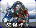 | 磁爆步兵 / `SHK` | 苏军 | 步兵 | 基础 |  |
| 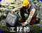 | 工程师 / `ENGINEER` | 盟军 | 步兵 | 基础 |  |
|  | 火箭飞行兵 / `JUMPJET` | 盟军 | 步兵／空中单位 | 雷达后 |  |
|  | 尤里 / `YURI` | 苏军 | 步兵 | 作战实验室后 |  |
|  | 疯狂伊文 / `IVAN` | 苏军 | 步兵 | 雷达后 |  |
| 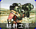 | 辐射工兵 / `DESO` | 苏军 | 步兵 | 雷达后 | 国家专属 |
|  | 军犬 / `DOG` | 苏军 | 步兵 | 基础 |  |
| 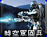 | 超时空军团兵 / `CLEG` | 盟军 | 步兵 | 作战实验室后 |  |
|  | 间谍 / `SPY` | 盟军 | 步兵 | 作战实验室后 |  |
|  | 超时空突击队 / `CCOMAND` | 盟军 | 步兵 | 间谍偷实验室后 | T4（主榜也收录） |
|  | 心灵突击队 / `PTROOP` | 盟军 | 步兵 | 间谍偷实验室后 | T4（主榜也收录） |
|  | 超时空伊文 / `CIVAN` | 苏军 | 步兵 | 间谍偷实验室后 | T4（主榜也收录） |
|  | 尤里改 / `YURIPR` | 苏军 | 步兵 | 间谍偷实验室后 | T4（主榜也收录） |
| 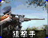 | 狙击手 / `SNIPE` | 盟军 | 步兵 | 雷达后 | 国家专属 |
| 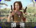 | 谭雅 / `TANY` | 盟军 | 步兵 | 作战实验室后 |  |
| 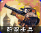 | 防空步兵 / `FLAKT` | 苏军 | 步兵 | 雷达后 |  |
| 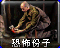 | 恐怖分子 / `TERROR` | 苏军 | 步兵 | 雷达后 | 国家专属 |
|  | 工程师 / `SENGINEER` | 苏军 | 步兵 | 基础 |  |
|  | 军犬 / `ADOG` | 盟军 | 步兵 | 基础 |  |
| 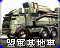 | 盟军基地车 / `AMCV` | 盟军 | 地面载具 | 基础 |  |
|  | 武装采矿车 / `HARV` | 苏军 | 地面载具 | 基础 |  |
|  | 天启坦克 / `APOC` | 苏军 | 地面载具 | 作战实验室后 |  |
| 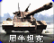 | 犀牛坦克 / `HTNK` | 苏军 | 地面载具 | 基础 |  |
| 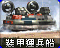 | 苏军运输船 / `SAPC` | 苏军 | 海军 | 基础 |  |
| 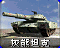 | 灰熊坦克 / `MTNK` | 盟军 | 地面载具 | 基础 |  |
| 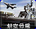 | 航空母舰 / `CARRIER` | 盟军 | 海军 | 作战实验室后 |  |
|  | V3 火箭发射车 / `V3` | 苏军 | 地面载具 | 雷达后 |  |
| 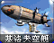 | 基洛夫空艇 / `ZEP` | 苏军 | 空中单位 | 作战实验室后 |  |
|  | 恐怖机器人 / `DRON` | 苏军 | 地面载具 | 基础 |  |
|  | 防空履带车 / `HTK` | 苏军 | 地面载具 | 基础 |  |
| 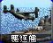 | 驱逐舰 / `DEST` | 盟军 | 海军 | 基础 |  |
| 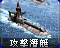 | 台风潜艇 / `SUB` | 苏军 | 海军 | 基础 |  |
| 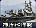 | 神盾巡洋舰 / `AEGIS` | 盟军 | 海军 | 雷达后 |  |
| 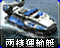 | 盟军运输船 / `LCRF` | 盟军 | 海军 | 基础 |  |
| 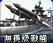 | 无畏级战舰 / `DRED` | 苏军 | 海军 | 作战实验室后 |  |
| 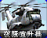 | 夜鹰直升机 / `SHAD` | 盟军 | 空中单位 | 基础 |  |
| 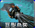 | 巨型乌贼 / `SQD` | 苏军 | 海军 | 作战实验室后 |  |
| 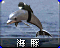 | 海豚 / `DLPH` | 盟军 | 海军 | 作战实验室后 |  |
| 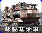 | 苏军基地车 / `SMCV` | 苏军 | 地面载具 | 基础 |  |
|  | 坦克杀手 / `TNKD` | 盟军 | 地面载具 | 雷达后 | 国家专属 |
|  | 磁能坦克 / `TTNK` | 苏军 | 地面载具 | 雷达后 | 国家专属 |
|  | 超时空采矿车 / `CMIN` | 盟军 | 地面载具 | 基础 |  |
| 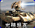 | 光棱坦克 / `SREF` | 盟军 | 地面载具 | 作战实验室后 |  |
| 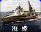 | 海蝎 / `HYD` | 苏军 | 海军 | 雷达后 |  |
|  | 幻影坦克 / `MGTK` | 盟军 | 地面载具 | 作战实验室后 |  |
| 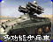 | 多功能步兵车 / `FV` | 盟军 | 地面载具 | 基础 |  |
| 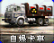 | 自爆卡车 / `DTRUCK` | 苏军 | 地面载具 | 雷达后 | 国家专属 |
| 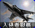 | 入侵者战机 / `ORCA` | 盟军 | 空中单位 | 雷达后 |  |
| 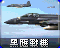 | 黑鹰战机 / `BEAG` | 盟军 | 空中单位 | 雷达后 | 国家专属 |
|  | 发电厂 / `GAPOWR` | 盟军 | 普通建筑 | 基础 |  |
| 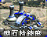 | 盟军矿石精炼厂 / `GAREFN` | 盟军 | 普通建筑 | 基础 |  |
|  | 盟军建造厂 / `GACNST` | 盟军 | 普通建筑 | 基础 | 无独立图标，使用阵营标志 |
| 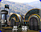 | 盟军兵营 / `GAPILE` | 盟军 | 普通建筑 | 基础 |  |
| 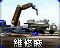 | 盟军维修厂 / `GADEPT` | 盟军 | 普通建筑 | 基础 |  |
|  | 盟军作战实验室 / `GATECH` | 盟军 | 普通建筑 | 雷达后 |  |
|  | 盟军战车工厂 / `GAWEAP` | 盟军 | 普通建筑 | 基础 |  |
|  | 磁能反应炉 / `NAPOWR` | 苏军 | 普通建筑 | 基础 |  |
| 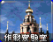 | 苏军作战实验室 / `NATECH` | 苏军 | 普通建筑 | 雷达后 |  |
|  | 苏军兵营 / `NAHAND` | 苏军 | 普通建筑 | 基础 |  |
| 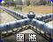 | 盟军围墙 / `GAWALL` | 盟军 | 防御及超级武器 | 基础 |  |
|  | 雷达 / `NARADR` | 苏军 | 普通建筑 | 基础 |  |
|  | 苏军战车工厂 / `NAWEAP` | 苏军 | 普通建筑 | 基础 |  |
| 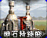 | 苏军矿石精炼厂 / `NAREFN` | 苏军 | 普通建筑 | 基础 |  |
| 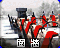 | 苏军围墙 / `NAWALL` | 苏军 | 防御及超级武器 | 基础 |  |
| 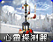 | 心灵探测器 / `NAPSIS` | 苏军 | 防御及超级武器 | 作战实验室后 |  |
| 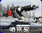 | 哨戒炮 / `NALASR` | 苏军 | 防御及超级武器 | 基础 |  |
| 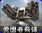 | 爱国者导弹 / `NASAM` | 盟军 | 防御及超级武器 | 基础 |  |
| 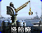 | 盟军船厂 / `GAYARD` | 盟军 | 普通建筑 | 基础 |  |
|  | 铁幕装置 / `NAIRON` | 苏军 | 防御及超级武器 | 作战实验室后 |  |
|  | 苏军建造厂 / `NACNST` | 苏军 | 普通建筑 | 基础 | 无独立图标，使用阵营标志 |
| 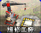 | 苏军维修厂 / `NADEPT` | 苏军 | 普通建筑 | 基础 |  |
|  | 超时空传送仪 / `GACSPH` | 盟军 | 防御及超级武器 | 作战实验室后 |  |
|  | 天气控制机 / `GAWEAT` | 盟军 | 防御及超级武器 | 作战实验室后 |  |
| 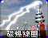 | 磁暴线圈 / `TESLA` | 苏军 | 防御及超级武器 | 雷达后 |  |
| 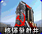 | 核弹发射井 / `NAMISL` | 苏军 | 防御及超级武器 | 作战实验室后 |  |
| 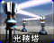 | 光棱塔 / `ATESLA` | 盟军 | 防御及超级武器 | 雷达后 |  |
| 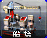 | 苏军船厂 / `NAYARD` | 苏军 | 普通建筑 | 基础 |  |
| 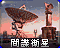 | 间谍卫星 / `GASPYSAT` | 盟军 | 防御及超级武器 | 作战实验室后 |  |
| 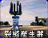 | 裂缝产生器 / `GAGAP` | 盟军 | 防御及超级武器 | 作战实验室后 |  |
|  | 巨炮 / `GTGCAN` | 盟军 | 防御及超级武器 | 雷达后 | 国家专属 |
| 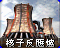 | 核子反应炉 / `NANRCT` | 苏军 | 普通建筑 | 作战实验室后 |  |
| 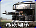 | 机枪碉堡 / `GAPILL` | 盟军 | 防御及超级武器 | 基础 |  |
|  | 防空炮 / `NAFLAK` | 苏军 | 防御及超级武器 | 基础 |  |
| 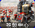 | 复制中心 / `NACLON` | 苏军 | 普通建筑 | 作战实验室后 |  |
|  | 矿石精炼器 / `GAOREP` | 盟军 | 普通建筑 | 作战实验室后 |  |
|  | 空指部 / `GAAIRC` | 盟军 | 普通建筑 | 基础 |  |
|  | 美国空指部 / `AMRADR` | 盟军 | 普通建筑 | 基础 | 国家专属 |
