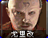

# 红警 2 原版 · 兵营页面

[返回版本索引](../README.md) · [返回总索引](../../README.md)

红警 2 原版 · 主榜 · 全部阵营 / 兵营页面 / 全部科技；共 21 项。

| 图片 | 名称／游戏 ID | 阵营 | 原分类 | 科技阶段 | 说明 |
|---|---|---|---|---|---|
|  | 美国大兵 / `E1` | 盟军 | 步兵 | 基础 |  |
|  | 动员兵 / `E2` | 苏军 | 步兵 | 基础 |  |
|  | 磁爆步兵 / `SHK` | 苏军 | 步兵 | 基础 |  |
|  | 工程师 / `ENGINEER` | 盟军 | 步兵 | 基础 |  |
|  | 火箭飞行兵 / `JUMPJET` | 盟军 | 步兵／空中单位 | 雷达后 |  |
|  | 尤里 / `YURI` | 苏军 | 步兵 | 作战实验室后 |  |
|  | 疯狂伊文 / `IVAN` | 苏军 | 步兵 | 雷达后 |  |
|  | 辐射工兵 / `DESO` | 苏军 | 步兵 | 雷达后 | 国家专属 |
|  | 军犬 / `DOG` | 苏军 | 步兵 | 基础 |  |
|  | 超时空军团兵 / `CLEG` | 盟军 | 步兵 | 作战实验室后 |  |
|  | 间谍 / `SPY` | 盟军 | 步兵 | 作战实验室后 |  |
|  | 超时空突击队 / `CCOMAND` | 盟军 | 步兵 | 间谍偷实验室后 | T4（主榜也收录） |
|  | 心灵突击队 / `PTROOP` | 盟军 | 步兵 | 间谍偷实验室后 | T4（主榜也收录） |
|  | 超时空伊文 / `CIVAN` | 苏军 | 步兵 | 间谍偷实验室后 | T4（主榜也收录） |
|  | 尤里改 / `YURIPR` | 苏军 | 步兵 | 间谍偷实验室后 | T4（主榜也收录） |
|  | 狙击手 / `SNIPE` | 盟军 | 步兵 | 雷达后 | 国家专属 |
|  | 谭雅 / `TANY` | 盟军 | 步兵 | 作战实验室后 |  |
|  | 防空步兵 / `FLAKT` | 苏军 | 步兵 | 雷达后 |  |
|  | 恐怖分子 / `TERROR` | 苏军 | 步兵 | 雷达后 | 国家专属 |
|  | 工程师 / `SENGINEER` | 苏军 | 步兵 | 基础 |  |
|  | 军犬 / `ADOG` | 盟军 | 步兵 | 基础 |  |
