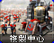

# 红警 2 原版 · 普通建筑

[返回版本索引](../README.md) · [返回总索引](../../README.md)

红警 2 原版 · 主榜 · 全部阵营 / 普通建筑 / 全部科技；共 22 项。

| 图片 | 名称／游戏 ID | 阵营 | 原分类 | 科技阶段 | 说明 |
|---|---|---|---|---|---|
|  | 发电厂 / `GAPOWR` | 盟军 | 普通建筑 | 基础 |  |
|  | 盟军矿石精炼厂 / `GAREFN` | 盟军 | 普通建筑 | 基础 |  |
|  | 盟军建造厂 / `GACNST` | 盟军 | 普通建筑 | 基础 | 无独立图标，使用阵营标志 |
|  | 盟军兵营 / `GAPILE` | 盟军 | 普通建筑 | 基础 |  |
|  | 盟军维修厂 / `GADEPT` | 盟军 | 普通建筑 | 基础 |  |
|  | 盟军作战实验室 / `GATECH` | 盟军 | 普通建筑 | 雷达后 |  |
|  | 盟军战车工厂 / `GAWEAP` | 盟军 | 普通建筑 | 基础 |  |
|  | 磁能反应炉 / `NAPOWR` | 苏军 | 普通建筑 | 基础 |  |
|  | 苏军作战实验室 / `NATECH` | 苏军 | 普通建筑 | 雷达后 |  |
|  | 苏军兵营 / `NAHAND` | 苏军 | 普通建筑 | 基础 |  |
|  | 雷达 / `NARADR` | 苏军 | 普通建筑 | 基础 |  |
|  | 苏军战车工厂 / `NAWEAP` | 苏军 | 普通建筑 | 基础 |  |
|  | 苏军矿石精炼厂 / `NAREFN` | 苏军 | 普通建筑 | 基础 |  |
|  | 盟军船厂 / `GAYARD` | 盟军 | 普通建筑 | 基础 |  |
|  | 苏军建造厂 / `NACNST` | 苏军 | 普通建筑 | 基础 | 无独立图标，使用阵营标志 |
|  | 苏军维修厂 / `NADEPT` | 苏军 | 普通建筑 | 基础 |  |
|  | 苏军船厂 / `NAYARD` | 苏军 | 普通建筑 | 基础 |  |
|  | 核子反应炉 / `NANRCT` | 苏军 | 普通建筑 | 作战实验室后 |  |
|  | 复制中心 / `NACLON` | 苏军 | 普通建筑 | 作战实验室后 |  |
|  | 矿石精炼器 / `GAOREP` | 盟军 | 普通建筑 | 作战实验室后 |  |
|  | 空指部 / `GAAIRC` | 盟军 | 普通建筑 | 基础 |  |
|  | 美国空指部 / `AMRADR` | 盟军 | 普通建筑 | 基础 | 国家专属 |
