# 尤里的复仇 · 作战实验室后

[返回版本索引](../README.md) · [返回总索引](../../README.md)

尤里的复仇 · 主榜 · 全部阵营 / 全部类别 / 作战实验室后；共 29 项。

此索引按“全部类别”查询；登月火箭员仅在空中类别查询出现，不设科技阶段。

| 图片 | 名称／游戏 ID | 阵营 | 原分类 | 科技阶段 | 说明 |
|---|---|---|---|---|---|
|  | 超时空军团兵 / `CLEG` | 盟军 | 步兵 | 作战实验室后 |  |
|  | 间谍 / `SPY` | 盟军 | 步兵 | 作战实验室后 |  |
|  | 尤里 X / `YURIPR` | 尤里 | 步兵 | 作战实验室后 |  |
|  | 谭雅 / `TANY` | 盟军 | 步兵 | 作战实验室后 |  |
|  | 鲍里斯 / `BORIS` | 苏军 | 步兵 | 作战实验室后 |  |
| 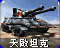 | 天启坦克 / `APOC` | 苏军 | 地面载具 | 作战实验室后 |  |
| 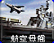 | 航空母舰 / `CARRIER` | 盟军 | 海军 | 作战实验室后 |  |
| 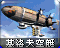 | 基洛夫空艇 / `ZEP` | 苏军 | 空中单位 | 作战实验室后 |  |
| 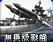 | 无畏级战舰 / `DRED` | 苏军 | 海军 | 作战实验室后 |  |
| 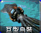 | 巨型乌贼 / `SQD` | 苏军 | 海军 | 作战实验室后 |  |
|  | 海豚 / `DLPH` | 盟军 | 海军 | 作战实验室后 |  |
|  | 光棱坦克 / `SREF` | 盟军 | 地面载具 | 作战实验室后 |  |
| 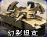 | 幻影坦克 / `MGTK` | 盟军 | 地面载具 | 作战实验室后 |  |
| 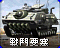 | 战斗要塞 / `BFRT` | 盟军 | 地面载具 | 作战实验室后 |  |
| 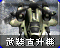 | 武装直升机 / `SCHP` | 苏军 | 空中单位 | 作战实验室后 |  |
| 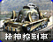 | 精神控制车 / `MIND` | 尤里 | 地面载具 | 作战实验室后 |  |
| 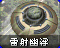 | 镭射幽浮 / `DISK` | 尤里 | 空中单位 | 作战实验室后 |  |
|  | 铁幕装置 / `NAIRON` | 苏军 | 防御及超级武器 | 作战实验室后 |  |
|  | 超时空传送仪 / `GACSPH` | 盟军 | 防御及超级武器 | 作战实验室后 |  |
|  | 天气控制机 / `GAWEAT` | 盟军 | 防御及超级武器 | 作战实验室后 |  |
|  | 核弹发射井 / `NAMISL` | 苏军 | 防御及超级武器 | 作战实验室后 |  |
|  | 间谍卫星 / `GASPYSAT` | 盟军 | 防御及超级武器 | 作战实验室后 |  |
|  | 裂缝产生器 / `GAGAP` | 盟军 | 防御及超级武器 | 作战实验室后 |  |
|  | 核子反应炉 / `NANRCT` | 苏军 | 普通建筑 | 作战实验室后 |  |
| 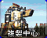 | 复制中心 / `NACLON` | 尤里 | 防御及超级武器 | 作战实验室后 |  |
| 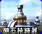 | 矿石精炼器 / `GAOREP` | 盟军 | 普通建筑 | 作战实验室后 |  |
| 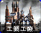 | 工业工厂 / `NAINDP` | 苏军 | 普通建筑 | 作战实验室后 |  |
| 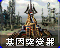 | 基因突变器 / `YAGNTC` | 尤里 | 防御及超级武器 | 作战实验室后 |  |
| 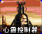 | 心灵控制器 / `YAPPET` | 尤里 | 防御及超级武器 | 作战实验室后 |  |
