# 尤里的复仇 · 雷达后

[返回版本索引](../README.md) · [返回总索引](../../README.md)

尤里的复仇 · 主榜 · 全部阵营 / 全部类别 / 雷达后；共 26 项。

此索引按“全部类别”查询；登月火箭员仅在空中类别查询出现，不设科技阶段。

| 图片 | 名称／游戏 ID | 阵营 | 原分类 | 科技阶段 | 说明 |
|---|---|---|---|---|---|
|  | 火箭飞行兵 / `JUMPJET` | 盟军 | 步兵／空中单位 | 雷达后 |  |
| 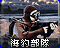 | 海豹突击队 / `GHOST` | 盟军 | 步兵 | 雷达后 |  |
| 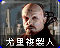 | 尤里复制人 / `YURI` | 尤里 | 步兵 | 雷达后 |  |
|  | 疯狂伊文 / `IVAN` | 苏军 | 步兵 | 雷达后 |  |
|  | 辐射工兵 / `DESO` | 苏军 | 步兵 | 雷达后 | 国家专属 |
|  | 狙击手 / `SNIPE` | 盟军 | 步兵 | 雷达后 | 国家专属 |
|  | 防空步兵 / `FLAKT` | 苏军 | 步兵 | 雷达后 |  |
|  | 恐怖分子 / `TERROR` | 苏军 | 步兵 | 雷达后 | 国家专属 |
| 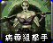 | 病毒狙击手 / `VIRUS` | 尤里 | 步兵 | 雷达后 |  |
|  | V3 火箭发射车 / `V3` | 苏军 | 地面载具 | 雷达后 |  |
| 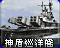 | 神盾巡洋舰 / `AEGIS` | 盟军 | 海军 | 雷达后 |  |
|  | 坦克杀手 / `TNKD` | 盟军 | 地面载具 | 雷达后 | 国家专属 |
|  | 磁能坦克 / `TTNK` | 苏军 | 地面载具 | 雷达后 | 国家专属 |
| 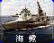 | 海蝎 / `HYD` | 苏军 | 海军 | 雷达后 |  |
|  | 自爆卡车 / `DTRUCK` | 苏军 | 地面载具 | 雷达后 | 国家专属 |
| 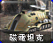 | 磁电坦克 / `TELE` | 尤里 | 地面载具 | 雷达后 |  |
| 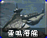 | 雷鸣攻击潜艇 / `BSUB` | 尤里 | 海军 | 雷达后 |  |
| 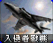 | 入侵者战机 / `ORCA` | 盟军 | 空中单位 | 雷达后 |  |
| 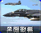 | 黑鹰战机 / `BEAG` | 盟军 | 空中单位 | 雷达后 | 国家专属 |
|  | 盟军作战实验室 / `GATECH` | 盟军 | 普通建筑 | 雷达后 |  |
|  | 苏军作战实验室 / `NATECH` | 苏军 | 普通建筑 | 雷达后 |  |
|  | 磁暴线圈 / `TESLA` | 苏军 | 防御及超级武器 | 雷达后 |  |
|  | 光棱塔 / `ATESLA` | 盟军 | 防御及超级武器 | 雷达后 |  |
|  | 巨炮 / `GTGCAN` | 盟军 | 防御及超级武器 | 雷达后 | 国家专属 |
| 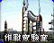 | 尤里作战实验室 / `YATECH` | 尤里 | 普通建筑 | 雷达后 |  |
| 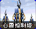 | 心灵控制塔 / `YAPSYT` | 尤里 | 防御及超级武器 | 雷达后 |  |
