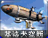
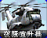
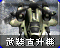
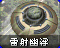
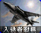
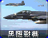
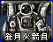

# 尤里的复仇 · 空中单位

[返回版本索引](../README.md) · [返回总索引](../../README.md)

尤里的复仇 · 主榜 · 全部阵营 / 空中单位 / 全部科技；共 8 项。

| 图片 | 名称／游戏 ID | 阵营 | 原分类 | 科技阶段 | 说明 |
|---|---|---|---|---|---|
|  | 火箭飞行兵 / `JUMPJET` | 盟军 | 步兵／空中单位 | 雷达后 |  |
|  | 基洛夫空艇 / `ZEP` | 苏军 | 空中单位 | 作战实验室后 |  |
|  | 夜鹰直升机 / `SHAD` | 盟军 | 空中单位 | 基础 |  |
|  | 武装直升机 / `SCHP` | 苏军 | 空中单位 | 作战实验室后 |  |
|  | 镭射幽浮 / `DISK` | 尤里 | 空中单位 | 作战实验室后 |  |
|  | 入侵者战机 / `ORCA` | 盟军 | 空中单位 | 雷达后 |  |
|  | 黑鹰战机 / `BEAG` | 盟军 | 空中单位 | 雷达后 | 国家专属 |
|  | 登月火箭员 / `LUNR` | 苏军 | 空中单位 | 无常规阶段 | 仅空中类别显示；科技筛选不限 |
