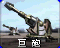
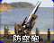
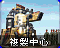
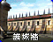
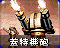
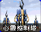
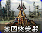
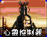
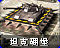
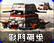

# 尤里的复仇 · 防御及超级武器

[返回版本索引](../README.md) · [返回总索引](../../README.md)

尤里的复仇 · 主榜 · 全部阵营 / 防御及超级武器 / 全部科技；共 23 项。

| 图片 | 名称／游戏 ID | 阵营 | 原分类 | 科技阶段 | 说明 |
|---|---|---|---|---|---|
|  | 盟军围墙 / `GAWALL` | 盟军 | 防御及超级武器 | 基础 |  |
|  | 苏军围墙 / `NAWALL` | 苏军 | 防御及超级武器 | 基础 |  |
|  | 哨戒炮 / `NALASR` | 苏军 | 防御及超级武器 | 基础 |  |
|  | 爱国者导弹 / `NASAM` | 盟军 | 防御及超级武器 | 基础 |  |
|  | 铁幕装置 / `NAIRON` | 苏军 | 防御及超级武器 | 作战实验室后 |  |
|  | 超时空传送仪 / `GACSPH` | 盟军 | 防御及超级武器 | 作战实验室后 |  |
|  | 天气控制机 / `GAWEAT` | 盟军 | 防御及超级武器 | 作战实验室后 |  |
|  | 磁暴线圈 / `TESLA` | 苏军 | 防御及超级武器 | 雷达后 |  |
|  | 核弹发射井 / `NAMISL` | 苏军 | 防御及超级武器 | 作战实验室后 |  |
|  | 光棱塔 / `ATESLA` | 盟军 | 防御及超级武器 | 雷达后 |  |
|  | 间谍卫星 / `GASPYSAT` | 盟军 | 防御及超级武器 | 作战实验室后 |  |
|  | 裂缝产生器 / `GAGAP` | 盟军 | 防御及超级武器 | 作战实验室后 |  |
|  | 巨炮 / `GTGCAN` | 盟军 | 防御及超级武器 | 雷达后 | 国家专属 |
|  | 机枪碉堡 / `GAPILL` | 盟军 | 防御及超级武器 | 基础 |  |
|  | 防空炮 / `NAFLAK` | 苏军 | 防御及超级武器 | 基础 |  |
|  | 复制中心 / `NACLON` | 尤里 | 防御及超级武器 | 作战实验室后 |  |
|  | 尤里围墙 / `GAFWLL` | 尤里 | 防御及超级武器 | 基础 |  |
|  | 盖特机炮 / `YAGGUN` | 尤里 | 防御及超级武器 | 基础 |  |
|  | 心灵控制塔 / `YAPSYT` | 尤里 | 防御及超级武器 | 雷达后 |  |
|  | 基因突变器 / `YAGNTC` | 尤里 | 防御及超级武器 | 作战实验室后 |  |
|  | 心灵控制器 / `YAPPET` | 尤里 | 防御及超级武器 | 作战实验室后 |  |
|  | 坦克碉堡 / `NATBNK` | 尤里 | 防御及超级武器 | 基础 |  |
|  | 战斗碉堡 / `NABNKR` | 苏军 | 防御及超级武器 | 基础 |  |
