# 尤里的复仇 · 地面载具

[返回版本索引](../README.md) · [返回总索引](../../README.md)

尤里的复仇 · 主榜 · 全部阵营 / 地面载具 / 全部科技；共 25 项。

| 图片 | 名称／游戏 ID | 阵营 | 原分类 | 科技阶段 | 说明 |
|---|---|---|---|---|---|
|  | 盟军基地车 / `AMCV` | 盟军 | 地面载具 | 基础 |  |
|  | 武装采矿车 / `HARV` | 苏军 | 地面载具 | 基础 |  |
|  | 天启坦克 / `APOC` | 苏军 | 地面载具 | 作战实验室后 |  |
|  | 犀牛坦克 / `HTNK` | 苏军 | 地面载具 | 基础 |  |
|  | 灰熊坦克 / `MTNK` | 盟军 | 地面载具 | 基础 |  |
| 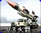 | V3 火箭发射车 / `V3` | 苏军 | 地面载具 | 雷达后 |  |
|  | 恐怖机器人 / `DRON` | 苏军 | 地面载具 | 基础 |  |
|  | 防空履带车 / `HTK` | 苏军 | 地面载具 | 基础 |  |
|  | 苏军基地车 / `SMCV` | 苏军 | 地面载具 | 基础 |  |
|  | 坦克杀手 / `TNKD` | 盟军 | 地面载具 | 雷达后 | 国家专属 |
| 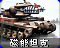 | 磁能坦克 / `TTNK` | 苏军 | 地面载具 | 雷达后 | 国家专属 |
| 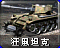 | 狂风坦克 / `LTNK` | 尤里 | 地面载具 | 基础 |  |
|  | 超时空采矿车 / `CMIN` | 盟军 | 地面载具 | 基础 |  |
|  | 光棱坦克 / `SREF` | 盟军 | 地面载具 | 作战实验室后 |  |
|  | 幻影坦克 / `MGTK` | 盟军 | 地面载具 | 作战实验室后 |  |
|  | 多功能步兵车 / `FV` | 盟军 | 地面载具 | 基础 |  |
|  | 自爆卡车 / `DTRUCK` | 苏军 | 地面载具 | 雷达后 | 国家专属 |
| 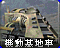 | 尤里基地车 / `PCV` | 尤里 | 地面载具 | 基础 |  |
| 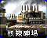 | 奴隶矿车 / `SMIN` | 尤里 | 地面载具 | 基础 |  |
| 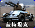 | 盖特机炮坦克 / `YTNK` | 尤里 | 地面载具 | 基础 |  |
| 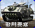 | 战斗要塞 / `BFRT` | 盟军 | 地面载具 | 作战实验室后 |  |
| 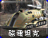 | 磁电坦克 / `TELE` | 尤里 | 地面载具 | 雷达后 |  |
| 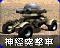 | 混乱机器人 / `CAOS` | 尤里 | 地面载具 | 基础 |  |
| 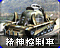 | 精神控制车 / `MIND` | 尤里 | 地面载具 | 作战实验室后 |  |
| 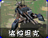 | 遥控坦克 / `ROBO` | 盟军 | 地面载具 | 基础 |  |
