# 尤里的复仇 · 海军

[返回版本索引](../README.md) · [返回总索引](../../README.md)

尤里的复仇 · 主榜 · 全部阵营 / 海军 / 全部科技；共 12 项。

| 图片 | 名称／游戏 ID | 阵营 | 原分类 | 科技阶段 | 说明 |
|---|---|---|---|---|---|
| 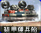 | 苏军运输船 / `SAPC` | 苏军 | 海军 | 基础 |  |
| 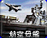 | 航空母舰 / `CARRIER` | 盟军 | 海军 | 作战实验室后 |  |
| 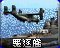 | 驱逐舰 / `DEST` | 盟军 | 海军 | 基础 |  |
| 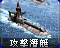 | 台风潜艇 / `SUB` | 苏军 | 海军 | 基础 |  |
| 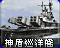 | 神盾巡洋舰 / `AEGIS` | 盟军 | 海军 | 雷达后 |  |
| 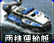 | 盟军运输船 / `LCRF` | 盟军 | 海军 | 基础 |  |
| 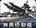 | 无畏级战舰 / `DRED` | 苏军 | 海军 | 作战实验室后 |  |
| 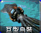 | 巨型乌贼 / `SQD` | 苏军 | 海军 | 作战实验室后 |  |
|  | 海豚 / `DLPH` | 盟军 | 海军 | 作战实验室后 |  |
| 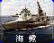 | 海蝎 / `HYD` | 苏军 | 海军 | 雷达后 |  |
| 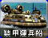 | 尤里运输船 / `YHVR` | 尤里 | 海军 | 基础 |  |
| 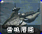 | 雷鸣攻击潜艇 / `BSUB` | 尤里 | 海军 | 雷达后 |  |
