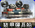
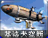
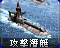
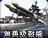
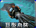
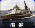
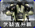
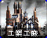
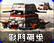

# 尤里的复仇 · 苏军

[返回版本索引](../README.md) · [返回总索引](../../README.md)

尤里的复仇 · 主榜 · 苏军 / 全部类别 / 全部科技；共 46 项。

| 图片 | 名称／游戏 ID | 阵营 | 原分类 | 科技阶段 | 说明 |
|---|---|---|---|---|---|
|  | 动员兵 / `E2` | 苏军 | 步兵 | 基础 |  |
|  | 磁爆步兵 / `SHK` | 苏军 | 步兵 | 基础 |  |
|  | 疯狂伊文 / `IVAN` | 苏军 | 步兵 | 雷达后 |  |
|  | 辐射工兵 / `DESO` | 苏军 | 步兵 | 雷达后 | 国家专属 |
|  | 军犬 / `DOG` | 苏军 | 步兵 | 基础 |  |
|  | 超时空突击队 / `CCOMAND` | 盟军 | 步兵 | 间谍偷实验室后 | T4（主榜也收录） |
|  | 心灵突击队 / `PTROOP` | 盟军 | 步兵 | 间谍偷实验室后 | T4（主榜也收录） |
|  | 超时空伊文 / `CIVAN` | 盟军 | 步兵 | 间谍偷实验室后 | T4（主榜也收录） |
|  | 防空步兵 / `FLAKT` | 苏军 | 步兵 | 雷达后 |  |
|  | 恐怖分子 / `TERROR` | 苏军 | 步兵 | 雷达后 | 国家专属 |
|  | 工程师 / `SENGINEER` | 苏军 | 步兵 | 基础 |  |
|  | 鲍里斯 / `BORIS` | 苏军 | 步兵 | 作战实验室后 |  |
|  | 武装采矿车 / `HARV` | 苏军 | 地面载具 | 基础 |  |
|  | 天启坦克 / `APOC` | 苏军 | 地面载具 | 作战实验室后 |  |
|  | 犀牛坦克 / `HTNK` | 苏军 | 地面载具 | 基础 |  |
|  | 苏军运输船 / `SAPC` | 苏军 | 海军 | 基础 |  |
|  | V3 火箭发射车 / `V3` | 苏军 | 地面载具 | 雷达后 |  |
|  | 基洛夫空艇 / `ZEP` | 苏军 | 空中单位 | 作战实验室后 |  |
|  | 恐怖机器人 / `DRON` | 苏军 | 地面载具 | 基础 |  |
|  | 防空履带车 / `HTK` | 苏军 | 地面载具 | 基础 |  |
|  | 台风潜艇 / `SUB` | 苏军 | 海军 | 基础 |  |
|  | 无畏级战舰 / `DRED` | 苏军 | 海军 | 作战实验室后 |  |
|  | 巨型乌贼 / `SQD` | 苏军 | 海军 | 作战实验室后 |  |
|  | 苏军基地车 / `SMCV` | 苏军 | 地面载具 | 基础 |  |
|  | 磁能坦克 / `TTNK` | 苏军 | 地面载具 | 雷达后 | 国家专属 |
|  | 海蝎 / `HYD` | 苏军 | 海军 | 雷达后 |  |
|  | 自爆卡车 / `DTRUCK` | 苏军 | 地面载具 | 雷达后 | 国家专属 |
|  | 武装直升机 / `SCHP` | 苏军 | 空中单位 | 作战实验室后 |  |
|  | 磁能反应炉 / `NAPOWR` | 苏军 | 普通建筑 | 基础 |  |
|  | 苏军作战实验室 / `NATECH` | 苏军 | 普通建筑 | 雷达后 |  |
|  | 苏军兵营 / `NAHAND` | 苏军 | 普通建筑 | 基础 |  |
|  | 雷达 / `NARADR` | 苏军 | 普通建筑 | 基础 |  |
|  | 苏军战车工厂 / `NAWEAP` | 苏军 | 普通建筑 | 基础 |  |
|  | 苏军矿石精炼厂 / `NAREFN` | 苏军 | 普通建筑 | 基础 |  |
|  | 苏军围墙 / `NAWALL` | 苏军 | 防御及超级武器 | 基础 |  |
|  | 哨戒炮 / `NALASR` | 苏军 | 防御及超级武器 | 基础 |  |
|  | 铁幕装置 / `NAIRON` | 苏军 | 防御及超级武器 | 作战实验室后 |  |
|  | 苏军建造厂 / `NACNST` | 苏军 | 普通建筑 | 基础 | 无独立图标，使用阵营标志 |
|  | 苏军维修厂 / `NADEPT` | 苏军 | 普通建筑 | 基础 |  |
|  | 磁暴线圈 / `TESLA` | 苏军 | 防御及超级武器 | 雷达后 |  |
|  | 核弹发射井 / `NAMISL` | 苏军 | 防御及超级武器 | 作战实验室后 |  |
|  | 苏军船厂 / `NAYARD` | 苏军 | 普通建筑 | 基础 |  |
|  | 核子反应炉 / `NANRCT` | 苏军 | 普通建筑 | 作战实验室后 |  |
|  | 防空炮 / `NAFLAK` | 苏军 | 防御及超级武器 | 基础 |  |
|  | 工业工厂 / `NAINDP` | 苏军 | 普通建筑 | 作战实验室后 |  |
|  | 战斗碉堡 / `NABNKR` | 苏军 | 防御及超级武器 | 基础 |  |
