# 尤里的复仇 · 尤里

[返回版本索引](../README.md) · [返回总索引](../../README.md)

尤里的复仇 · 主榜 · 尤里 / 全部类别 / 全部科技；共 35 项。

| 图片 | 名称／游戏 ID | 阵营 | 原分类 | 科技阶段 | 说明 |
|---|---|---|---|---|---|
|  | 尤里复制人 / `YURI` | 尤里 | 步兵 | 雷达后 |  |
|  | 超时空突击队 / `CCOMAND` | 盟军 | 步兵 | 间谍偷实验室后 | T4（主榜也收录） |
|  | 心灵突击队 / `PTROOP` | 盟军 | 步兵 | 间谍偷实验室后 | T4（主榜也收录） |
|  | 超时空伊文 / `CIVAN` | 盟军 | 步兵 | 间谍偷实验室后 | T4（主榜也收录） |
|  | 尤里 X / `YURIPR` | 尤里 | 步兵 | 作战实验室后 |  |
|  | 工程师 / `YENGINEER` | 尤里 | 步兵 | 基础 |  |
| 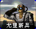 | 尤里新兵 / `INIT` | 尤里 | 步兵 | 基础 |  |
|  | 狂兽人 / `BRUTE` | 尤里 | 步兵 | 基础 |  |
| 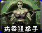 | 病毒狙击手 / `VIRUS` | 尤里 | 步兵 | 雷达后 |  |
| 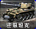 | 狂风坦克 / `LTNK` | 尤里 | 地面载具 | 基础 |  |
| 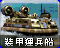 | 尤里运输船 / `YHVR` | 尤里 | 海军 | 基础 |  |
| 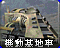 | 尤里基地车 / `PCV` | 尤里 | 地面载具 | 基础 |  |
| 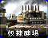 | 奴隶矿车 / `SMIN` | 尤里 | 地面载具 | 基础 |  |
| 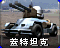 | 盖特机炮坦克 / `YTNK` | 尤里 | 地面载具 | 基础 |  |
| 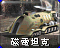 | 磁电坦克 / `TELE` | 尤里 | 地面载具 | 雷达后 |  |
| 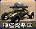 | 混乱机器人 / `CAOS` | 尤里 | 地面载具 | 基础 |  |
| 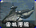 | 雷鸣攻击潜艇 / `BSUB` | 尤里 | 海军 | 雷达后 |  |
| 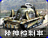 | 精神控制车 / `MIND` | 尤里 | 地面载具 | 作战实验室后 |  |
| 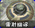 | 镭射幽浮 / `DISK` | 尤里 | 空中单位 | 作战实验室后 |  |
| 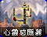 | 心灵感应器 / `NAPSIS` | 尤里 | 普通建筑 | 基础 |  |
| 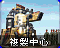 | 复制中心 / `NACLON` | 尤里 | 防御及超级武器 | 作战实验室后 |  |
| 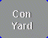 | 尤里建造厂 / `YACNST` | 尤里 | 普通建筑 | 基础 |  |
|  | 生化反应炉 / `YAPOWR` | 尤里 | 普通建筑 | 基础 |  |
| 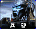 | 尤里兵营 / `YABRCK` | 尤里 | 普通建筑 | 基础 |  |
| 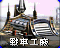 | 尤里战车工厂 / `YAWEAP` | 尤里 | 普通建筑 | 基础 |  |
| 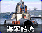 | 尤里船厂 / `YAYARD` | 尤里 | 普通建筑 | 基础 |  |
| 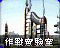 | 尤里作战实验室 / `YATECH` | 尤里 | 普通建筑 | 雷达后 |  |
| 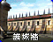 | 尤里围墙 / `GAFWLL` | 尤里 | 防御及超级武器 | 基础 |  |
| 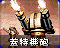 | 盖特机炮 / `YAGGUN` | 尤里 | 防御及超级武器 | 基础 |  |
| 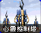 | 心灵控制塔 / `YAPSYT` | 尤里 | 防御及超级武器 | 雷达后 |  |
| 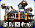 | 部队回收厂 / `YAGRND` | 尤里 | 普通建筑 | 基础 |  |
| 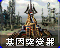 | 基因突变器 / `YAGNTC` | 尤里 | 防御及超级武器 | 作战实验室后 |  |
| 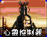 | 心灵控制器 / `YAPPET` | 尤里 | 防御及超级武器 | 作战实验室后 |  |
| 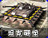 | 坦克碉堡 / `NATBNK` | 尤里 | 防御及超级武器 | 基础 |  |
|  | 奴隶矿场 / `YAREFN` | 尤里 | 普通建筑 | 基础 |  |
